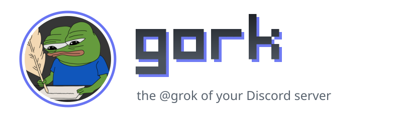
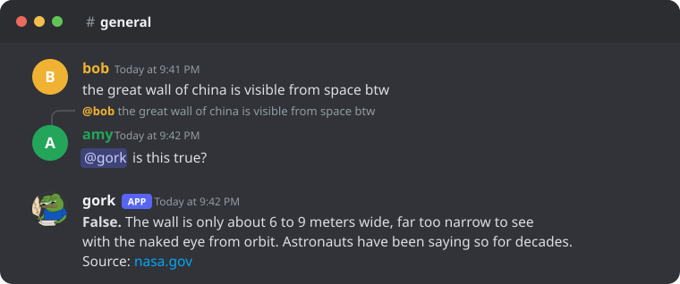

<p align="center">
  <picture>
    <source media="(prefers-color-scheme: dark)" srcset="assets/banner-dark.svg">
    
  </picture>
</p>

<p align="center">
  <b>Mention it. Ask it anything.</b><br>
  An ultralight-cost, self-hosted Discord bot that fact-checks, searches the web, reads links, videos and images,<br>
  and makes images, polls and events. It runs on your own computer, for your own server.
</p>

<p align="center">
  <a href="https://github.com/ultralightspeed/gork/actions/workflows/ci.yml"></a>
  <a href="LICENSE"></a>
</p>

<p align="center">
  <a href="#quickstart">Quickstart</a> ·
  <a href="#what-gork-can-do">Features</a> ·
  <a href="#what-it-costs">Costs</a> ·
  <a href="docs/audit.md#privacy">Privacy</a> ·
  <a href="docs/setup.md">Setup guide</a> ·
  <a href="docs/troubleshooting.md">Troubleshooting</a>
</p>

<p align="center">
  
</p>

## What gork can do

Reply to any message with `@gork is this true?`, or just ask it something. It reads the message you replied to and the recent chat, then answers in the thread.

- Fact-checks claims and searches the web for current facts.
- Reads web pages people share.
- Watches short videos posted in Discord, up to 60 seconds: frames and speech.
- Reads YouTube transcripts from a video link. This uses an undocumented YouTube interface that can break at any time; when it does, gork says transcripts are unavailable and everything else keeps working.
- Sees images, link previews and forwarded messages.
- Generates images from a description.
- Makes native Discord polls and events, in your time zone.
- Talks in one of five personalities, or one you write in the setup page.
- Screens every request and reply for harmful content, and posts nothing if the screen is down.

gork is built for a small private server of people you know. You run it yourself; nobody else hosts it for you. It is not a public multi-server bot.

## Quickstart

Setting up gork takes about 15 minutes, and you don't write any code. You install two free programs, type one command, and a page in your web browser walks you through the rest.

Already at home in a terminal? With Docker or Podman running:

```sh
git clone --branch v0.1.3 https://github.com/ultralightspeed/gork.git
cd gork
npm run setup
```

### What you need

- A Windows, Mac or Linux computer that stays on while you want gork online. gork runs on it, not in the cloud.
- A Discord account, and a server where you may add bots (your own server is fine).
- A free Cloudflare account. Sign up at <https://dash.cloudflare.com/sign-up> and confirm your email.

### 1. Install two free programs

- **Node.js**, version 24 or newer: download it from <https://nodejs.org/> (the **LTS** button), run the installer and keep the default choices.
- **Docker Desktop**: download it from <https://www.docker.com/products/docker-desktop/> and install it. Open it once and wait until it says the engine is running. [Podman Desktop](https://podman-desktop.io/) works too.

<details>
<summary>Other ways to run containers</summary>

Only Docker's or Podman's command-line tools with Compose are needed, not a Desktop app. On Linux, Docker Engine with the Compose plugin, or Podman 4.7 or newer with docker-compose or podman-compose, is enough. Anything else that gives you a working `docker compose` (OrbStack, Colima, Rancher Desktop and so on) works the same way, since those are the only commands gork runs. Docker must be 23 or newer, which reads the image's compressed layers. gork uses Docker if it works and Podman otherwise.

</details>

### 2. Download gork

Open the [latest release](https://github.com/ultralightspeed/gork/releases/latest) and, under **Assets**, click **Source code (zip)**. A release is a finished version; the code on the main page can be ahead of it. Unzip the file (on Windows: right-click it, then **Extract All**). Find the folder that holds `package.json` and `README.md`, rename it to `gork`, and put it anywhere you like, such as your Documents folder.

### 3. Open a terminal in that folder

A terminal is a window where you type commands.

- **Windows**: open the `gork` folder, click the address bar at the top of the window, type `cmd` and press Enter. A black Command Prompt window opens, already in the right folder.
- **Mac**: open **Terminal** (press Cmd+Space, type `Terminal`, press Enter). Type `cd` and a space, drag the `gork` folder into the Terminal window, and press Enter.
- **Linux**: right-click inside the folder and choose **Open in Terminal**.

### 4. Start the setup page

Type this and press Enter:

```sh
npm run setup
```

It opens a page in your web browser (or prints an address to copy into it). Nothing else needs installing: `npm run setup` uses only what comes with Node, and gork's own parts come inside its container image. It runs gork's own code from this folder, as you; no gork command needs an administrator or `sudo`. Paste tokens only into this page, whose address starts with `http://127.0.0.1:`. The page walks you through four steps:

1. Choose how gork pays for the model (free or credits, see [What it costs](#what-it-costs)), its personality, who it may mention and your time zone.
2. Create the bot in Discord and paste its token into the page. The page shows where to click, turns on the settings gork needs, and shows you the server gork joined so you can confirm it.
3. Create a one-time Cloudflare setup token and paste it into the page. The page creates two Cloudflare tokens limited to what gork needs, sets up the AI Gateway, tests everything, and deletes the setup token.
4. Click **Save the settings**, which writes your settings to a file named `.env`, then **Start gork**.

Starting gork downloads its ready-made image, which GitHub builds from this repository for each release ([how to check it](docs/setup.md#checking-the-image)). That takes a few minutes. If the download fails, gork builds the image on your computer instead, which takes 15 to 30 minutes (longer on a Raspberry Pi). Leave the terminal window open until the page says gork is online. Then go to your server and write `@gork hello`.

### Afterwards

Run these in a terminal opened in the gork folder: `npm run up` starts gork again (after a restart, or after you change a setting), and `npm run down` stops it. To get a new version of gork, see [Updating gork](docs/setup.md#updating-gork). If something doesn't work, run `npm run doctor` and fix the `FAIL` lines it shows, then see [docs/troubleshooting.md](docs/troubleshooting.md). [docs/setup.md](docs/setup.md) covers every step of the page, setting up by hand, and the everyday commands.

## What it costs

Usually a few cents a day: a cent or two for replies, and up to 10 cents more on days with many web searches. The setup page asks which billing mode you want, and your answer is the `BILLING_MODE` setting.

- Credits mode uses prepaid Cloudflare credits (the minimum top-up is $10). Everything works, including web search. gork stops for the day at a daily budget (`DAILY_BUDGET_USD`, 50 cents by default), and the AI Gateway gets a spend limit of about 1.2 times that as a second line of defense.
- Free mode uses only Cloudflare's free daily Workers AI allowance, on the Workers Free plan, and costs nothing. Its limits: roughly 25 to 100 replies a day, no web search, a smaller model that can't see images (videos give only their transcript), and once the day's allowance is gone gork says so and answers nothing until 00:00 UTC. See [docs/setup.md](docs/setup.md#free-mode-in-detail).

The default model is [GLM-5.3 Flash](https://developers.cloudflare.com/workers-ai/models/glm-5.3-flash/), an open-weights model from Zhipu (Z.ai) in China, which Cloudflare runs on its own servers. Your messages go to Cloudflare, not to the model's makers. Cloudflare says it [does not use what you send Workers AI to train models](https://developers.cloudflare.com/workers-ai/platform/data-usage/) and does not keep it after answering. You can switch models with `LLM_MODEL`; then also set `LLM_PRICE_IN_PER_M` and `LLM_PRICE_OUT_PER_M` to that model's prices, because gork's daily cap is only as accurate as those numbers.

Rough prices (they change, so check Cloudflare's pricing pages):

| What | Cost |
|---|---|
| A normal reply (default model) | about $0.001 to $0.002 |
| A reply's first web search (Ceramic) | $0.00025 ($0.25 per 1,000 searches) |
| Each further search in a reply, or a retry when the first fails or finds nothing (Linkup) | $0.005, at most 2 a reply and 20 a day (about $0.10) |
| Page reads, YouTube transcripts, polls, events | nothing extra |
| Safety check, generated images, video speech-to-text | see below; on Workers Paid about $0.0005 for the speech in a full 60-second clip |

Web search tries [Ceramic](https://ceramic.ai/) first because it is cheap, but its index is weak on new things, such as a game that came out last month. So a reply's further searches, and a first search that fails or finds nothing, go to [Linkup](https://www.linkup.so/), which costs 20 times as much. The model searching again is the sign that the first results missed. Set `SEARCH_FALLBACK=none` to use only Ceramic, or `SEARCH_PROVIDER=linkup` to use Linkup for every search. Neither keeps a copy of your search queries; Exa, the third choice, does. The daily count restarts when gork does, and the daily budget always caps what gork spends. When gork starts, its log says which providers it uses and what the fallback can cost a day.

The safety check, image generation and video speech-to-text call Workers AI directly, in both modes. They never use your credits, and the gateway's spend limit does not cover them. On the Workers Free plan they use the free daily allowance and cost nothing. On Workers Paid, Cloudflare bills what goes past that allowance.

At the default 50-cent cap, gork can answer roughly 250 to 500 simple replies a day, so $10 of credits covers about 5,000 to 10,000 simple replies. A reply that searches costs more, about a cent when it uses the fallback, and so does one that reads a long transcript, so a server that searches a lot gets fewer replies for the same money. Keep auto top-up off in Cloudflare: on the Workers Free plan your credit balance is then the most a leaked token could spend. On Workers Paid, a leaked runtime token could also run Workers AI models directly, billed to your account, so delete it in the Cloudflare dashboard if it leaks. Cloudflare may charge a small fee when you buy credits.

## More

- [Setup guide](docs/setup.md): the setup page step by step, setting up by hand, Docker or Podman, checking the image, free mode, everyday commands, updating, and keeping gork online.
- [What gork does in your server](docs/behavior.md): the safety screen, pings (`MENTIONS`), events (`TIMEZONE`), polls, images and link previews.
- [Personalities](docs/personalities.md): the five presets and how to write your own.
- [Privacy and auditing](docs/audit.md): what leaves your computer and where it goes. When someone mentions gork, recent messages from that channel go to Cloudflare, so tell your server members.
- [Troubleshooting](docs/troubleshooting.md).
- Settings: every setting is in `.env`, and [`.env.example`](.env.example) lists them all with defaults. After you change `.env`, run `npm run up` again.
- [CONTRIBUTING.md](CONTRIBUTING.md) to work on gork, [SECURITY.md](SECURITY.md) to report a vulnerability, and [AGENTS.md](AGENTS.md) for AI coding agents that install or change gork.

## License

Everything in the universe is in the public domain, including this bot.

gork is released under the [Zero-Clause BSD license](LICENSE) (0BSD), a public-domain-equivalent license. Use it for anything; no attribution needed.

gork is not affiliated with xAI or X.
